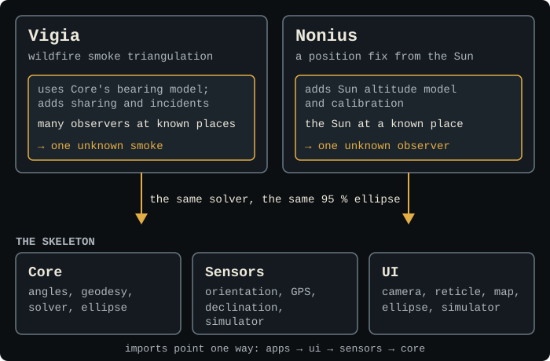

# Alidade

Alidade turns a phone into a sighting instrument: compass, tilt sensors, camera and GPS give a
direction or an altitude, and several of them give a position with its honest 95 % error ellipse.
It is one skeleton and two apps that are duals of one problem:

- **Vigia**: many observers at known places, one unknown smoke column. Wildfire triangulation.
- **Nonius**: one observer at an unknown place, the Sun at a known place. A position without GPS.

Entry for Kiroween 2026, category Skeleton Crew.



The skeleton is three packages. Each app brings a measurement model that tells the shared solver what its observations are. Vigia uses the bearing model that Core ships and adds sharing and incidents; Nonius adds its own altitude model and the calibration of the phone's altitude error. To add your own, start from one of the three real extension points:
[`measurement-model.ts`](skeleton/core/src/measurement-model.ts) (the interface),
[`bearing-model.ts`](skeleton/core/src/bearing-model.ts) (Vigia's, in Core) and
[`altitude-model.ts`](apps/nonius/src/math/fix/altitude-model.ts) (Nonius's, in the app).

## Try it

| What                | Link                                                                                      |
| ------------------- | ----------------------------------------------------------------------------------------- |
| Landing page        | <https://johnnybazzinga.github.io/alidade/>                                               |
| Vigia               | <https://johnnybazzinga.github.io/alidade/vigia/> (on a laptop add `?mode=simulator`)     |
| Nonius              | <https://johnnybazzinga.github.io/alidade/nonius/> (choose Simulator on the first screen) |
| Skeleton playground | <https://johnnybazzinga.github.io/alidade/playground/>                                    |

Every scene in the simulators is made up. Neither app calls or notifies anyone.

## What is in the repository

| Path                                     | What it is                                                                                                                                |
| ---------------------------------------- | ----------------------------------------------------------------------------------------------------------------------------------------- |
| [`skeleton/core`](skeleton/core)         | `@alidade/core`: pure math. Angles, spherical geodesy, observations, the solver, the uncertainty ellipse. No runtime dependency.          |
| [`skeleton/sensors`](skeleton/sensors)   | `@alidade/sensors`: device orientation, GPS, magnetic declination, and a seeded simulator behind the same interface.                      |
| [`skeleton/ui`](skeleton/ui)             | `@alidade/ui`: camera image, sighting reticle, map with the ellipse layer, simulator panel, playground page.                              |
| [`apps/vigia`](apps/vigia)               | Smoke triangulation from several people's sightings, with a wind layer and a text to read to the emergency number.                        |
| [`apps/nonius`](apps/nonius)             | Sun sights, the phone's altitude error, and a position fix without GPS.                                                                   |
| [`tools/kiro-guard`](tools/kiro-guard)   | Hook commands for Kiro. They refuse calls the project forbids and report the state of the repository.                                     |
| [`tools/alidade-mcp`](tools/alidade-mcp) | An MCP server over stdio that exposes the skeleton's math to an agent as three tools.                                                     |
| [`site`](site)                           | The landing page of the published site: one static page, no script, no request.                                                           |
| [`probe`](probe)                         | The first sensor probe, written before the skeleton: a throwaway page that compared phone readings with the Sun. Not a workspace package. |
| [`docs`](docs)                           | `privacy.md`: what leaves the phone, channel by channel. `skeleton.svg`: the diagram above.                                               |

## The skeleton as a skeleton

Nonius was built after Vigia without changing the source of `skeleton/core` or `skeleton/sensors`.
To check it, one command finds the commit that added Nonius's requirements and compares the two
source folders with the current ones, leaving out the test files:

```
git diff $(git log --format=%h --diff-filter=A -1 -- .kiro/specs/nonius/requirements.md) HEAD -- skeleton/core/src skeleton/sensors/src ':!*.test.ts'
```

It prints nothing. The same diff without the last pathspec shows only tests: four lines in
`skeleton/core/src/observation.test.ts`, where a real place in a test position was replaced with a
synthetic one, and two new files, `readme.test.ts` in Core and in Sensors, which check that every
name their READMEs promise is exported.

`skeleton/ui` gained two optional properties for Nonius: `kind` on `DeviceSighting` (what a session
captures, `bearing` by default or `altitude`) and `hideSceneChooser` on `SimulatorPanel` (so the app
can offer its own scenes). Defaults leave Vigia unchanged.

The Sun-altitude measurement model lives in `apps/nonius`, not in Core. That is what Core's design
asked for: the solver is generic over measurement models, and Core ships only the bearing model.

## Honest limits

- Phone compasses are off by several degrees. Both apps say so.
- Every position is shown with its 95 % ellipse. None is shown without it.
- Vigia is not an emergency service. It helps describe where the smoke is. If there is fire, call
  the emergency number first.
- Nonius is a backup and a teaching instrument, not certified navigation.
- A phone's altitude reading carries a constant error, like a sextant's index error. Nonius can
  measure it, and without that calibration its fixes are of little use: one degree of altitude is
  about 111 km on the ground.
- Vigia's satellite-hotspot layer is not in this release. Its wind layer is.

## How it was built with Kiro

Counts below were made on 2026-11-28 from the files in this repository.

- **Six specs** in `.kiro/specs/` (`sighting-core`, `skeleton-sensors`, `skeleton-ui`, `vigia`,
  `nonius`, `kiro-tooling`), each with requirements, design and tasks: **90 requirements**
  (`### Requirement` headings), **859 acceptance criteria** (numbered items under each
  `#### Acceptance Criteria`), **120 task groups** and **420 sub-tasks** (checkbox lines in
  `tasks.md`, top-level and indented).
- **Five steering files** in `.kiro/steering/`: `math-conventions`, `product`, `structure`, `tech`,
  `testing`.
- **164 named properties** in property-based tests (`fast-check`): the distinct `P-n.m` identifiers
  in the 76 `*.property.test.ts` files, counted once per package because numbering restarts in each
  (`grep -ohE "P-[0-9]+\.[0-9]+"`, then `sort -u`).
- **6 440 tests** pass, 3 skipped, in 7 packages: the sum of the `Tests` lines of `pnpm test`.
- **The project agent** `.kiro/agents/alidade.json` loads the five steering files and the MCP
  server, denies reading and writing `notes/`, and denies `git commit`, `git push` and `pkill`. It
  has three hooks that run `tools/kiro-guard`: at session start it prints the branch, the last
  commit and the changed files; before every tool call it refuses by rule; at the end of a turn it
  prints the root checks when `skeleton/` or `apps/` changed. The guard has nine refusal rules:
  reading or writing `notes/`, `pkill`, `git commit`, `git push`, a dev server, a watch mode, an
  install without `--offline` or `--frozen-lockfile`, a test run without `timeout`, and a write
  outside the repository. It also refuses an event it cannot parse. It guards against mistakes and
  is not a security boundary.
- **Three IDE hooks** in `.kiro/hooks/`: run a math file's tests on save, check the format of a
  saved `requirements.md`, and refuse access to `notes/`. They were written to the schema in the
  Kiro documentation and checked against it by tests. They were not run in the Kiro IDE, so treat
  them as unverified there.
- **An MCP server**, `tools/alidade-mcp`, written by hand over stdio, with **three tools**:
  `fix_from_bearings`, `magnetic_declination`, `local_offset`. It is registered in
  `.kiro/settings/mcp.json`.

How the work was divided. Kiro (kiro-cli) wrote the six specs, and every line of code and every test up to Vigia's looks, working task by task from the specs. An orchestrating agent, Claude Code, driven by the author, wrote the prompts to Kiro, reviewed each checkpoint independently (its own numerical experiments, screenshots of the built pages in a headless browser), amended requirements when a review found a gap, approved Kiro's commands through a filter, and made the commits. Vigia's looks are the exception. The first, Field (skeleton-ui task groups 35 and 36, Vigia task groups 24 to 26): Kiro wrote its spec, did tasks 35.1 and 35.2 and began 35.3; when the Kiro account ran out of credits and more could not be bought in time, Claude Code wrote the rest from Kiro's spec. The second, Mira, which Vigia wears now, is the author's design: he drew five directions in a design tool and chose the third. Claude Code's part was to reproduce it in code, as a fourth theme of the skeleton and on Vigia's screens, and to write its amendments to the specs (skeleton-ui task group 37, Vigia task group 27). Each of those commits says so. Codex reviewed the specs, the phone flow and the look independently. The author chose the idea, made the product decisions, and tested the skeleton's sighting flow on an iPhone: the three permissions, the camera with the crosshair, orientation at 60 Hz, three compass directions matching Apple's Compass app, a first real bearing captured, and the map drawn over OpenStreetMap. The two-phone Vigia flow and Nonius's Sun sights on real phones are still to be filmed.

## Run it

Node 24 or newer and pnpm 11.24.0 (`engines` and `packageManager` in `package.json`).

```
pnpm install
pnpm test
pnpm typecheck
pnpm --filter @alidade/vigia build
pnpm --filter @alidade/nonius build
pnpm --filter @alidade/ui build:playground
pnpm --filter @alidade/mcp build
```

The builds write each package's `dist/`. The two apps read four variables at build time, listed in
`.env.example` of each app: `VITE_TILE_URL_TEMPLATE`, `VITE_TILE_ATTRIBUTION`,
`VITE_TILE_SOURCE_NAME` and `VITE_TILE_TERMS_URL`. With all four the map has tiles from that
provider. With any missing the map has a plain background and asks no tile server for anything.
The MCP server runs with `node tools/alidade-mcp/dist/server.mjs`, from the repository root.

## Data and credits

- Map tiles: © OpenStreetMap contributors, used under their tile policy for the trial builds. The
  repository itself names no tile provider.
- Wind: [Open-Meteo](https://open-meteo.com/), CC BY 4.0, free for non-commercial use.
- Sun reference values for Nonius's tests: published data of the U.S. Naval Observatory
  (`apps/nonius/fixtures/sun-published.json`).
- Magnetic declination: World Magnetic Model 2025, through the `magvar` package.
- Ephemerides: `astronomy-engine`. Maps: MapLibre GL JS.
- Licence: MIT, see [`LICENSE`](LICENSE).
- What leaves the phone: [`docs/privacy.md`](docs/privacy.md).
